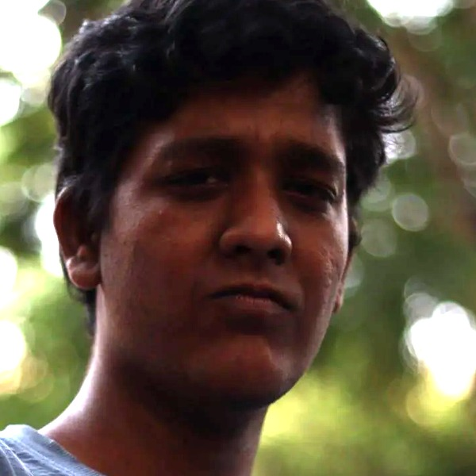
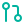

 

### Hey, I'm Shivanshu
**CS undergrad @ KIIT · Hyderabad, India**

---

##  About me

I chose **films, stories, and tech**, and somehow ended up building both. Python made me fall in love with code, and I've been hooked ever since.

-  Lead (Graphic Design) at **KIIT Film Society**, a 300+ member student society
-  Built **SentryX**, a kernel-level firewall using eBPF/XDP and Go
-  Shipped a billing & POS app for a real business
-  Built and maintain the KFS website and its members-only community platform
-  Exploring **AI/ML and app development**
-  Off-screen: Indian food, cooking, gaming and movies

---

##  Featured projects

| Project | What it does | Stack |
|---|---|---|
| **[SentryX](https://github.com/ShivanshuAgarwal/SentryX)** | Programmable firewall that filters packets in kernel space at the network driver, with live rule updates and cross-platform installers | eBPF/XDP, Go, CI/CD |
| **[Manju Enterprises](https://manjuent.vercel.app)** | Custom billing and point-of-sale app built around real business needs | JavaScript, Full-stack |
| **[KFS Website & Social Strand](https://kiitfilmsociety.in)** | Official society site with profiles, posts and event registration | HTML, CSS, JavaScript |

---

##  Tech stack

**Learning:** Kubernetes & cloud native · AI/ML · open source contributions

---

##  Badges

*Meshery Design Pioneer: built my first cloud native design with [Meshery](https://meshery.io).*

---

##  Currently

-  Contributing to open source (Meshery / CNCF ecosystem)
-  Sharpening DSA and backend skills
-  Telling stories through design and animation at KFS

---

##  Let's connect

-  **Email:** [shivanshuagrwl@gmail.com](mailto:shivanshuagrwl@gmail.com)
-  **LinkedIn:** [shivanshu-agarwal](https://www.linkedin.com/in/shivanshu-agarwal-587a76279/)
-  **My first site:** [kiitfilmsociety.in](https://kiitfilmsociety.in)

*Open to internships and open source collaboration. If you love movies, code or good biryani, let's talk.*

